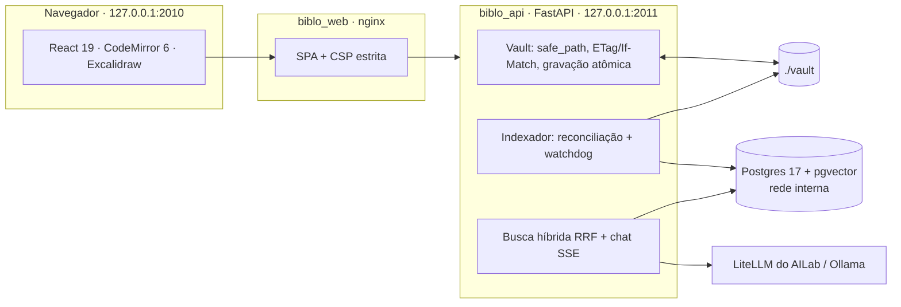

<p align="center"></p>

# Biblo: Knowledge Studio local-first

Notas em Markdown estilo Obsidian, diagramas e fluxos no Excalidraw e um copiloto que responde com base nos seus arquivos.
Tudo roda em localhost, e **a pasta `./vault/` é a única fonte da verdade**.

---

## O que o Biblo faz

| Painel | Recurso |
| :--- | :--- |
| **Vault** | Árvore de pastas do `./vault`: criar nota, diagrama e pasta em qualquer nível, renomear (`F2`), mover arrastando, excluir para `vault/.lixeira/`, filtro por nome |
| **Editor** | CodeMirror 6 com modos Editar, Dividido e Visualizar; `[[wikilinks]]` com autocomplete e `Ctrl+clique`; checklists clicáveis; tabelas; fluxogramas Mermaid; imagens do vault; estrutura do documento; backlinks e links de saída |
| **Canvas** | Excalidraw nativo (`.excalidraw` compatível com excalidraw.com e Obsidian), em português, com Mermaid para diagrama e fontes servidas localmente |
| **Copiloto** | Chat com streaming SSE sobre o vault: busca híbrida (FTS em português sem acento + vetorial pgvector, fundidas por RRF) e citações clicáveis para o arquivo e a linha |

Garantias local-first:

- **Autosave com proteção contra conflito**: grava 1,5 s depois da última edição, com `If-Match`. Se o arquivo mudou
  fora do Biblo (VS Code, `git pull`), aparece um modal para manter a sua versão, usar a do disco ou salvar uma cópia.
  Nada é sobrescrito em silêncio.
- **Disco é a verdade**: o índice do Postgres é descartável e é reconstruído do disco no boot. Mudanças externas chegam
  pelo watcher (inotify, com polling automático no WSL2 em `/mnt/*`).
- **Degradação honesta**: sem Ollama, a busca funciona só por texto e o status avisa. Sem gateway de LLM, o copiloto
  mostra o erro. Nenhuma resposta, modelo ou arquivo é simulado.

---

## Arquitetura



| Camada | Tecnologia |
| :--- | :--- |
| Frontend | React 19, Vite 8, TypeScript, CodeMirror 6, `@excalidraw/excalidraw` 0.18, markdown-it + DOMPurify, Mermaid 11 (sob demanda) |
| Backend | FastAPI, asyncpg, watchdog, cliente OpenAI-compatível |
| Dados | PostgreSQL 17 + pgvector (HNSW) + FTS `portuguese_unaccent` |
| IA | Chat: LiteLLM do AILab (`ailab_litellm:4000/v1`) ou Ollama `/v1`. Embeddings: Ollama `nomic-embed-text` (768 dim) ou `/v1/embeddings` |
| Design | Tokens e componentes em [`.docs/design-system/`](.docs/design-system/), protegidos por `npm run ds:check` |

---

## Como executar

Pré-requisitos: Docker com Compose v2 e a rede `ailab_net` (`docker network create ailab_net`).

```bash
cp .env.example .env                    # defina DB_PASSWORD (openssl rand -base64 24)
mkdir -p vault && cp -rn examples/vault/. vault/   # primeira vez: nota de boas-vindas
docker compose up -d --build
```

- Biblo: <http://127.0.0.1:2010>
- API (docs em `BIBLO_ENV=dev`): <http://127.0.0.1:2011/api/docs>
- Postgres: só na rede interna. Para inspecionar: `docker compose -f docker-compose.yml -f docker-compose.debug.yml up -d` (porta `127.0.0.1:2012`)

Busca semântica: Ollama no host com `nomic-embed-text`. Enquanto o provedor não responde, a busca é só textual e o
indexador completa os vetores quando ele volta. Chat: aponte `LLM_BASE_URL`/`LLM_API_KEY` para o LiteLLM do AILab ou para `http://host.docker.internal:11434/v1`.

### Desenvolvimento

```bash
docker compose up -d biblo_postgres biblo_api     # API em 127.0.0.1:2011
cd web && npm ci && npm run dev                    # Vite em 127.0.0.1:2010 com proxy /api
```

### Verificação

| O quê | Comando |
| :--- | :--- |
| Backend (ruff + pytest, inclui Postgres real) | `docker compose --profile test run --rm biblo_api_test` |
| Frontend (design system + typecheck + testes + build) | `cd web && npm run verify` |
| Só o design system | `cd web && npm run ds:check` |

---

## Segurança

A API não confia em "é localhost". Detalhes em [`.docs/arquitetura.md`](.docs/arquitetura.md).

| Ameaça | Proteção |
| :--- | :--- |
| Site malicioso escrevendo no vault (CSRF) | Sessão em cookie `HttpOnly` + `SameSite=Strict`; escrita exige `application/json`; `Origin` e `Sec-Fetch-Site` verificados |
| DNS rebinding | `TrustedHostMiddleware` (só `localhost`, `127.0.0.1`, `biblo_api`) |
| Path traversal | `resolve_safe_path`: resolução canônica, sem `..`, sem symlink, sem caminho absoluto, extensões permitidas |
| XSS por nota, asset ou resposta da IA | Markdown sem HTML bruto + DOMPurify; SVG servido como anexo; CSP `script-src 'self'` |
| Exfiltração por prompt injection | Contexto RAG fora do system prompt e escapado; imagens externas bloqueadas no preview e removidas do chat |
| Exposição de rede | Portas só em `127.0.0.1`; Postgres sem porta publicada; API roda com o UID do usuário, não como root |
| Custo de API | Limite de 10 mensagens/min e teto de contexto (`RAG_MAX_CONTEXT_TOKENS`) |

---

## Estrutura

```text
Biblo/
├── api/                    FastAPI: app/{routers,services,middlewares}, schema.sql, tests/
├── web/                    React + Vite: src/{components,lib,hooks,api,styles}
├── examples/vault/         Semente do vault (o ./vault real é seu e fica fora do Git)
├── scripts/design-system/  sync, check e pre-commit do design system
├── .docs/                  arquitetura.md, backend.md e design-system/ (tokens, componentes, marca, proteção)
├── docker-compose.yml      biblo_postgres, biblo_api, biblo_web (+ perfil test)
└── vault/                  Seus arquivos (.md, .excalidraw, assets/)
```

## Licença

[MIT](LICENSE).
