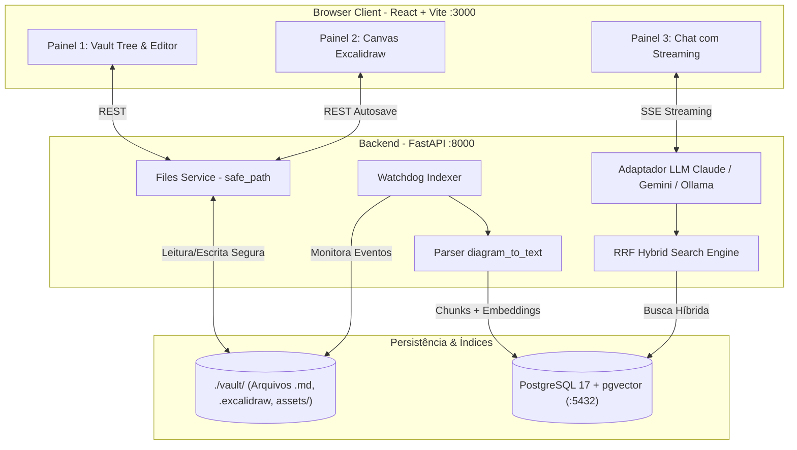

# 📚 Biblo — Knowledge Studio Local-First

> **Canvas Infinito · Biblioteca Markdown Estilo Obsidian · Chat com IA (RAG Híbrido)**  
> Gestão visual e textual do conhecimento em localhost com Docker, onde **seus arquivos locais são a única fonte da verdade**.

---

## 🌟 Visão Geral

O **Biblo** é um espaço de trabalho integrado (*Knowledge Studio*) desenvolvido para unir três modos essenciais de pensamento:
1. **Visual**: Desenhar diagramas, fluxogramas e mapas mentais em tela infinita.
2. **Textual**: Escrever notas, documentações e pesquisas em Markdown com links bidirecionais.
3. **Aumentado por IA**: Conversar com seus documentos e diagramas através de uma IA contextualizada que cruza textos e desenhos.

### 💡 Filosofia Central: O Arquivo é a Fonte da Verdade
Diferente de ferramentas que aprisionam seus dados em bancos relacionais proprietários ou na nuvem, o Biblo adota o comportamento **Local-First do Obsidian**:
* **Seus dados são arquivos reais em disco** dentro da pasta `./vault/` (`.md`, `.excalidraw` e imagens em `assets/`).
* Você pode abrir a pasta no VS Code, versionar com Git ou fazer backup simplesmente copiando a pasta.
* O banco de dados (**PostgreSQL com pgvector**) armazena apenas **índices de busca, vetores e metadados**. Se o banco for deletado ou quebrar, o índice é **reconstruído automaticamente a partir do disco**.

---

## 📐 Os 3 Recursos Centrais

```text
┌────────────────────────────────────────────────────────────────────────┐
│                                 BIBLO                                  │
├───────────────────┬──────────────────────────────────┬─────────────────┤
│    PAINEL 1       │             PAINEL 2             │    PAINEL 3     │
│  📁 VAULT         │  🎨 CANVAS INFINITO              │  🤖 CHAT COM IA │
│                   │                                  │                 │
│ ├─ notas/         │ • Tela infinita (Excalidraw)     │ • Streaming SSE │
│ │  ├─ arch.md     │ • Formas e setas conectadas      │ • RAG Híbrido   │
│ │  └─ regras.md   │ • Autosave debounce (1.5s)       │ • Busca Texto+  │
│ ├─ diagramas/     │ • Arquivo nativo .excalidraw     │   Vetorial      │
│ │  └─ fluxo.excal │ • Parser semântico p/ RAG        │ • Citações      │
│ └─ assets/        │                                  │   clicáveis     │
│                   │                                  │                 │
│ • [[wikilinks]]   │                                  │                 │
│ • Backlinks       │                                  │                 │
└───────────────────┴──────────────────────────────────┴─────────────────┘
```

### 1. 🎨 Canvas Infinito (Design & Fluxogramas)
- **Motor**: `@excalidraw/excalidraw` (Licença MIT permissiva — ideal para MVPs que podem evoluir para produtos comerciais sem taxas ou marcas d'água).
- **Recursos**: Tela infinita, formas geométricas, texto livre, agrupamentos e setas magnéticas ligadas a elementos.
- **Armazenamento**: Salvo como arquivo JSON nativo `.excalidraw` dentro de `./vault/diagramas/`.
- **Autosave**: Debounce de 1.5s que grava silenciosamente sem bloquear a edição.

### 2. 📝 Biblioteca de Notas Estilo Obsidian
- **Editor**: CodeMirror 6 com suporte a syntax highlighting para Markdown e Frontmatter YAML.
- **Links Bidirecionais**: Suporte nativo a `[[wikilinks]]` e tabela de backlinks calculada automaticamente pelo indexador.
- **Gestão de Imagens e Mídia**: Upload direto para a pasta `./vault/assets/`.
- **Navegação**: Árvore hierárquica de pastas e arquivos refletindo fielmente a pasta `./vault`.

### 3. 🤖 Chat com IA & RAG Híbrido Unificado (Textos + Desenhos)
A IA não lê todos os arquivos a cada pergunta: o indexador processa notas e diagramas, gera embeddings e consulta os trechos mais relevantes via busca híbrida.

- **O Diferencial — Diagramas Viram Texto**: Arquivos `.excalidraw` contêm coordenadas que não servem diretamente para embeddings. O parser `diagram_to_text` do Biblo traduz caixas, setas e textos em grafos relacionais legíveis por LLMs:
  ```text
  Fluxo:
  Pedido --[Validação]--> Estoque
  Estoque --[Sucesso]--> Faturamento
  Anotações: SLA de aprovação: 2 minutos; Gateway primário: Stripe
  ```
- **Busca Híbrida RRF (Reciprocal Rank Fusion)**: Combina busca vetorial de cosseno (HNSW) com busca textual clássica Full-Text Search (FTS em português via `to_tsvector`).
- **Adaptador Agnóstico de LLM**: Interface unificada permitindo alternar entre **Anthropic Claude**, **Google Gemini** ou modelos locais via **Ollama** via variáveis de ambiente.
- **Rastreabilidade e Citações Clicáveis**: As respostas da IA incluem citações no formato `[caminho/arquivo]` que abrem a nota ou diagrama correspondente com um clique.

---

## 🛠️ Stack Tecnológica

| Camada | Tecnologia | Motivo da Escolha |
| :--- | :--- | :--- |
| **Frontend** | React 19 + Vite + Tailwind CSS | Performance, экоossistema moderno e agilidade |
| **Canvas** | `@excalidraw/excalidraw` | Licença MIT livre, robustez de exportação e manipulação de formas |
| **Editor** | CodeMirror 6 | Modularidade, extensibilidade e suporte rápido a Markdown |
| **Backend** | FastAPI (Python 3.11+) | Async nativo, ecossistema líder em IA/RAG e suporte a SSE para streaming |
| **Banco / Vetores** | PostgreSQL 17 + `pgvector` | Banco único para metadados relacionais, busca FTS e busca vetorial HNSW |
| **Embeddings** | Ollama (`nomic-embed-text`) ou Google Gemini | Embeddings locais com zero custo ou via API rápida com 768 dimensões |
| **LLMs Suportadas** | Anthropic Claude / Google Gemini / Ollama | Flexibilidade configurável via adaptador unificado |
| **Watcher em Disco** | `watchdog` (Python) | Monitora alterações no filesystem e reindexa automaticamente |

---

## 🏗️ Arquitetura do Sistema



---

## 🗄️ Modelo de Dados (`db/init.sql`)

O banco de dados é inicializado com suporte a vetores e busca textual em português:

```sql
-- db/init.sql
CREATE EXTENSION IF NOT EXISTS vector;

-- Registro de documentos do vault
CREATE TABLE documents (
    id UUID PRIMARY KEY DEFAULT gen_random_uuid(),
    path TEXT UNIQUE NOT NULL,
    kind TEXT NOT NULL CHECK (kind IN ('markdown', 'diagram')),
    title TEXT NOT NULL,
    content_hash TEXT NOT NULL, -- evita reindexar o que não mudou
    updated_at TIMESTAMPTZ NOT NULL DEFAULT now()
);

-- Trechos indexados com embeddings e busca textual FTS
CREATE TABLE chunks (
    id BIGSERIAL PRIMARY KEY,
    document_id UUID NOT NULL REFERENCES documents(id) ON DELETE CASCADE,
    heading TEXT,
    text TEXT NOT NULL,
    embedding vector(768) NOT NULL,
    tsv tsvector GENERATED ALWAYS AS (to_tsvector('portuguese', text)) STORED
);

-- Índices de alta performance
CREATE INDEX ON chunks USING hnsw (embedding vector_cosine_ops);
CREATE INDEX ON chunks USING gin (tsv);

-- Relações de links e backlinks bidirecionais
CREATE TABLE links (
    source_id UUID REFERENCES documents(id) ON DELETE CASCADE,
    target TEXT NOT NULL
);
```

---

## 📁 Estrutura de Diretórios Recomendada

```text
Biblo/
├── .env.example              # Template de variáveis de ambiente
├── docker-compose.yml        # Orquestração de todos os serviços em localhost
├── README.md                 # Documentação oficial
├── LICENSE                   # Licença MIT
│
├── api/                      # Backend FastAPI (Python)
│   ├── app/
│   │   ├── main.py           # Entrypoint da API e CORS
│   │   ├── config.py         # Carregamento de configurações e envs
│   │   ├── routers/
│   │   │   ├── files.py      # Operações no vault (com safe_path)
│   │   │   ├── search.py     # Busca FTS e vetorial
│   │   │   └── chat.py       # Rota de chat com streaming SSE
│   │   ├── services/
│   │   │   ├── parser.py     # diagram_to_text e chunking de markdown
│   │   │   ├── indexer.py    # Watchdog e sincronização do vault
│   │   │   └── rag.py        # Busca Híbrida RRF e injeção de contexto
│   │   └── llm/
│   │       ├── base.py       # Interface/Protocolo LLM
│   │       ├── anthropic.py  # Adaptador Claude
│   │       ├── gemini.py     # Adaptador Google Gemini
│   │       └── ollama.py     # Adaptador Ollama
│   ├── requirements.txt
│   └── Dockerfile
│
├── web/                      # Frontend SPA (React + Vite)
│   ├── src/
│   │   ├── components/
│   │   │   ├── VaultTree.tsx       # Navegador de arquivos
│   │   │   ├── MarkdownEditor.tsx  # Editor CodeMirror 6
│   │   │   ├── Canvas.tsx          # Tela infinita Excalidraw
│   │   │   └── ChatPanel.tsx       # Chat de IA com citações
│   │   ├── App.tsx
│   │   └── main.tsx
│   ├── package.json
│   └── Dockerfile
│
├── db/                       # Inicialização do banco
│   └── init.sql              # Extensões, tabelas e índices pgvector
│
└── vault/                    # A fonte de dados (montada como volume)
    ├── notas/                # Suas notas .md
    ├── diagramas/            # Seus diagramas .excalidraw
    └── assets/               # Imagens e anexos
```

---

## 🚀 Como Executar em Localhost

### 1. Pré-requisitos
- [Docker](https://docs.docker.com/get-docker/) e [Docker Compose](https://docs.docker.com/compose/) instalados.
- Chave de API da [Anthropic](https://console.anthropic.com/) ou [Google AI Studio](https://aistudio.google.com/) (caso não use Ollama local).

### 2. Configurar Variáveis de Ambiente
Copie o arquivo de exemplo e preencha suas chaves:
```bash
cp .env.example .env
```

Exemplo de `.env`:
```ini
# Banco de Dados
DB_PASSWORD=biblo_secret_pass

# Seleção de Provedor de IA: anthropic | gemini | ollama
LLM_PROVIDER=gemini
LLM_MODEL=gemini-2.0-flash

# Chaves de API (necessária apenas a do provedor ativo)
ANTHROPIC_API_KEY=sua_chave_claude_aqui
GEMINI_API_KEY=sua_chave_gemini_aqui

# Provedor de Embeddings: gemini | ollama
EMBEDDING_PROVIDER=gemini
OLLAMA_URL=http://ollama:11434
```

### 3. Iniciar a Aplicação
Suba a stack completa em modo isolado para desenvolvimento local:
```bash
docker compose up -d
```

*(Se quiser rodar o modelo local via Ollama, execute com o perfil dedicado: `docker compose --profile local-ai up -d`).*

### 4. Acessar o Biblo
- **Interface Web**: [http://localhost:3000](http://localhost:3000)
- **API Swagger / Documentação**: [http://localhost:8000/docs](http://localhost:8000/docs)
- **PostgreSQL**: `localhost:5432`

---

## 🛡️ Segurança e Proteções do MVP

1. **Proteção contra Path Traversal**:
   O acesso ao sistema de arquivos é restrito exclusivamente ao diretório `./vault/` validado via `safe_path` (rejeitando requisições com `../` ou caminhos absolutos fora da pasta).
2. **Prevenção de Prompt Injection**:
   Trechos de notas e diagramas são injetados no prompt do sistema como **dados brutos citáveis**, instruindo a IA a ignorar comandos executáveis contidos dentro de arquivos.
3. **Isolamento de Credenciais**:
   Chaves de API (`ANTHROPIC_API_KEY`, `GEMINI_API_KEY`) residem exclusivamente no container de backend (`api`), nunca sendo expostas no código do navegador.
4. **Resolução de Conflitos de Gravação**:
   O sistema utiliza `content_hash` para identificar se um arquivo foi modificado externamente antes de sobrescrevê-lo.

---

## 🗺️ Roadmap de Evolução

- [x] **Fase 1 (MVP)**:
  - [x] Arquitetura Local-First com `./vault` em disco.
  - [x] Canvas infinito Excalidraw integrado.
  - [x] Editor Markdown com `[[wikilinks]]`.
  - [x] Parser `diagram_to_text` para indexação semântica de desenhos.
  - [x] Busca híbrida RRF com pgvector + FTS.
  - [x] Chat com streaming e adaptador Claude/Gemini.
- [ ] **Fase 2 (Próximos Passos)**:
  - [ ] Renderização de diagramas em PNG para RAG multimodal com modelos de visão.
  - [ ] Graph View visual de conexões entre notas e diagramas.
  - [ ] Colaboração em tempo real via CRDTs / Yjs.
  - [ ] Suporte a múltiplos vaults independentes.
  - [ ] Autenticação e controle de acesso via Keycloak / OIDC.

---

## 📄 Licença

Distribuído sob a licença **MIT**. Consulte o arquivo [`LICENSE`](LICENSE) para mais detalhes.