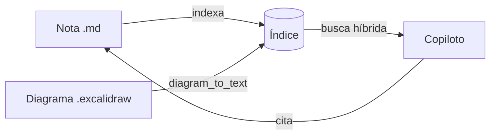

# Bem-vindo ao Biblo

O Biblo guarda tudo como **arquivos comuns** nesta pasta `vault/`. Você pode abrir a mesma pasta no VS Code,
versionar com Git ou copiar para backup. O banco de dados é só um índice: se ele sumir, o Biblo reconstrói tudo
a partir do disco.

## O que dá para fazer

- [ ] Escrever notas em Markdown, com `[[wikilinks]]` entre elas. Experimente: [[arquitetura]]
- [ ] Desenhar diagramas e fluxos no canvas Excalidraw (`.excalidraw`)
- [ ] Perguntar ao copiloto sobre as suas notas e diagramas, com citações clicáveis
- [ ] Organizar pastas: criar, renomear, arrastar para mover e excluir

## Fluxos dentro da nota

## Atalhos

| Ação | Atalho |
| --- | --- |
| Buscar arquivos e conteúdo | `Ctrl K` |
| Negrito / itálico | `Ctrl B` / `Ctrl I` |
| Abrir link sob o cursor | `Ctrl` + clique |
| Salvar agora | `Ctrl S` |
| Fechar aba | `Alt W` |
| Painel do vault / copiloto | `Ctrl Shift B` / `Ctrl Shift L` |
| Modo foco (oculta as laterais) | `Ctrl Shift F` |
